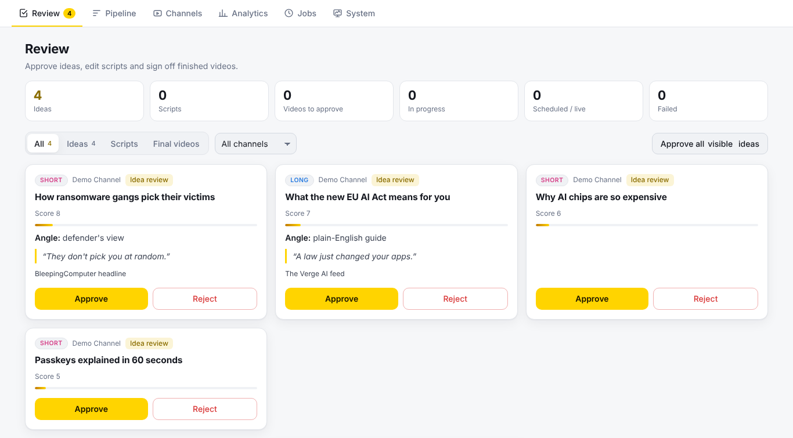
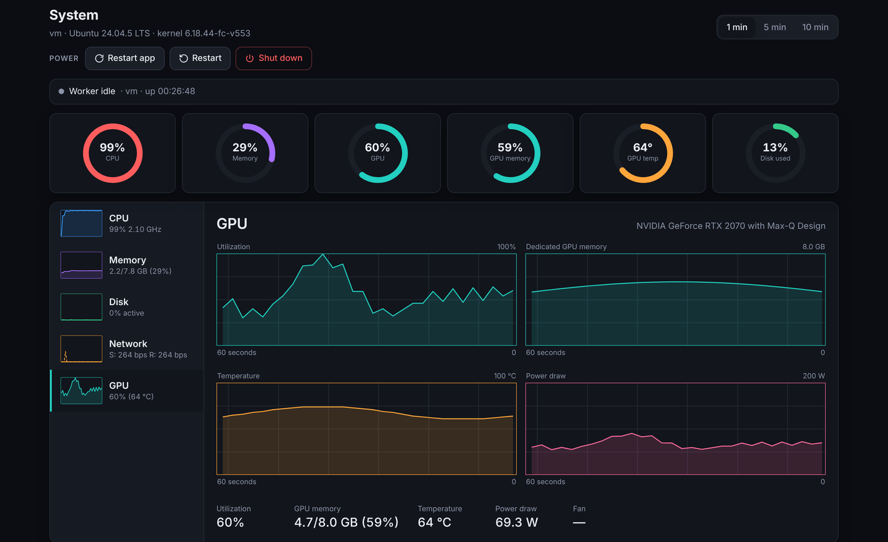
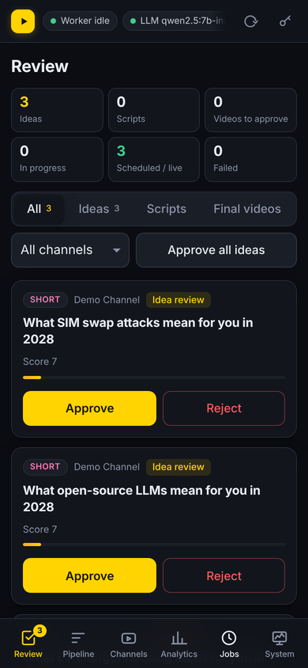
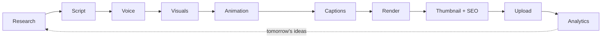

<div align="center">

# YT AI Manager

**Run several YouTube channels from one home server: AI finds the topics, writes the scripts, narrates, illustrates,
animates, captions and uploads; you approve each step from your phone.**

[](https://github.com/977Gurung/YouTube-AI-Manager/actions/workflows/ci.yml)




</div>

## What it does
YT AI Manager is a self-hosted, semi-automatic production pipeline for **YouTube Shorts and long videos** across
**multiple channels**. Everything runs locally on one NVIDIA GPU (built and tuned on an RTX 2070, 8 GB); the only
cloud services are YouTube itself and the trend sources it reads.

- **Research** – daily topic ideas from Google Trends (several countries), YouTube trending, news feeds, Reddit,
  competitor channels and your own past results
- **Scripts** – sectioned narration written by a local LLM (Ollama, Qwen2.5 7B), editable before production
- **Voice** – expressive local narration with adjustable emotion (Chatterbox), or Piper, Edge or ElevenLabs
- **Visuals** – your own clips first, then stock footage, then AI images (SDXL-Lightning)
- **AI animation** – stills turned into moving clips with LTX-Video
- **Captions** – animated word-by-word "pop" captions with key-word effects (Whisper timing)
- **Render** – ffmpeg with NVENC, background music ducked under the voice, loudness-normalised
- **Publishing** – thumbnails, titles, descriptions and tags; scheduled uploads into free slots; quota tracking;
  AI-content disclosure set automatically
- **You stay in control** – approve ideas, scripts and finished videos (per-channel gates) from a mobile-friendly
  dashboard
- **Operations** – n8n schedules and alerts, a Task Manager-style **System** tab with live CPU, memory, disk, network
  and GPU graphs, remote restart / shut down, health check (`./ytm.sh doctor`)

<p align="center">
  
  &nbsp;
  
</p>

## Requirements
| | |
|---|---|
| OS | Ubuntu 22.04 or 24.04 LTS (Desktop or Server) |
| GPU | NVIDIA with 8 GB VRAM and NVENC (RTX 2070 or better recommended) |
| RAM | 16 GB minimum, 32 GB recommended (AI animation) |
| Disk | 100 GB free recommended (AI models about 45 GB) |
| Accounts | Google account with a YouTube channel; Google Cloud project with the YouTube Data API (free) |

## Quick start
```bash
git clone https://github.com/977Gurung/YouTube-AI-Manager.git yt-ai-manager
cd yt-ai-manager
./install.sh                      # drivers, Ollama, Python env, n8n, services (re-runnable)
./ytm.sh fetch-models             # optional: AI images + animation models (~32 GB, once)
./ytm.sh setup-voice --enable     # optional: expressive voice (~6 GB, once)
```
Then:
1. Create a Google Cloud OAuth client and API key, put them in `secrets/` and `.env`
   ([guide](docs/installation.md#3-google-cloud-one-time-about-10-minutes)).
2. Describe your channels in `config/channels.yaml` and link each one: `./ytm.sh auth <slug>`.
3. Check everything: `./ytm.sh doctor`.
4. Open the dashboard at `http://localhost:8765` (or through an SSH tunnel / Tailscale) and approve the first ideas.

## Documentation
| Guide | Covers |
|---|---|
| [Installation](docs/installation.md) | Requirements, machine preparation, install options, Google Cloud, linking channels, remote access, upgrading |
| [Configuration](docs/configuration.md) | `.env`, `settings.yaml`, `channels.yaml`, visuals, voices, animation, captions |
| [Usage](docs/usage.md) | The pipeline and approval gates, dashboard tabs, commands, n8n workflows, going live |
| [Architecture](docs/architecture.md) | Components, production steps, status diagram, design choices, project layout |
| [API](docs/api.md) | REST endpoints |
| [Testing](docs/testing.md) | Quick checks, the full test suite, the live browser + n8n run |
| [Troubleshooting](docs/troubleshooting.md) | Common problems and fixes |

## How it works

You approve at three points (idea, script, finished video); each can be switched off per channel.
A FastAPI service with a single GPU worker (one job at a time, models unloaded between steps) does the work;
n8n triggers research, moves the pipeline forward and sends alerts; SQLite keeps the state. Video production runs
in a short-lived process so its memory is released after every video. Details: [Architecture](docs/architecture.md).

## Upgrading
```bash
git pull && ./scripts/upgrade.sh --in-place          # git clone
./scripts/upgrade.sh ~/yt-ai-manager-vX.Y.Z.zip       # release zip
```
Your `.env`, channels, data, tokens, models and media are kept. See [CHANGELOG.md](CHANGELOG.md).

## Versioning
[Semantic Versioning](https://semver.org): **MAJOR** needs manual steps, **MINOR** adds features, **PATCH** fixes.
Installed version: `./ytm.sh version`, the dashboard header, or `GET /api/health`.

## Responsible use
- Check the licences of the AI models, voices, music and stock footage before monetising; some have conditions
  (for example LTX-Video requires disclosing AI-generated content and has a revenue threshold). See
  [THIRD_PARTY_LICENSES.md](THIRD_PARTY_LICENSES.md).
- YouTube demonetises mass-produced, repetitive content. Keep the review gates on and add your own perspective.
- Only clone voices you own or have permission to use. Follow the YouTube Terms of Service and community guidelines.
- Videos uploaded through a Google Cloud project that hasn't passed the YouTube API audit stay private.

## Security
Keep the dashboard off the public internet; it is protected by an API key and meant for your LAN, an SSH tunnel or
a private network such as Tailscale. Secrets live in `.env`, `secrets/` and `data/tokens/`, which git ignores. See
[SECURITY.md](SECURITY.md).

## Contributing
Issues and pull requests are welcome; please read [CONTRIBUTING.md](CONTRIBUTING.md) and run `./scripts/check.sh`.

## License
[MIT](LICENSE) for this repository's code. Models, voices, fonts and tools downloaded by the installer keep their own
licences: [THIRD_PARTY_LICENSES.md](THIRD_PARTY_LICENSES.md).
