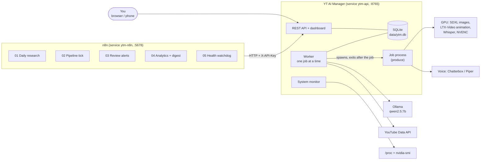
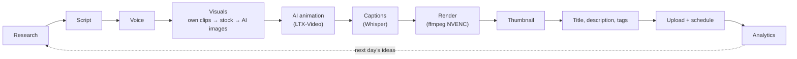
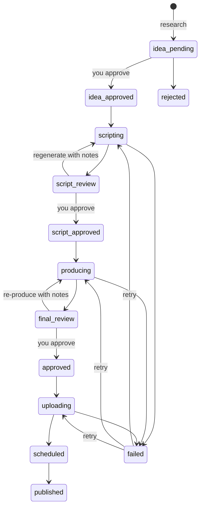

# Architecture

## Components


## Production steps


## Video status

Gates that are switched off for a channel (`approval_gates`) are passed automatically.

## Design choices for an 8 GB GPU
- **One job at a time.** The worker never runs two GPU jobs together; the LLM is unloaded before images, animation
  or Whisper load.
- **Video production runs in its own process** (`app/jobrun.py`) that exits after each job, so the several GB of
  model weights it loads are returned to the system. The service itself stays at a few hundred MB.
- **AI animation** encodes the text prompt on the CPU first, frees that encoder, then loads the video model with CPU
  offload and tiled decoding.
- **Fail soft.** Missing models, out-of-memory errors or time limits turn scenes into stills, or fall back to Piper
  for the voice, with the reason in the video's History, instead of failing the video.
- **Resumable.** Each step keeps its output; a retry or a restart continues from the last finished step.

## Project layout
```
app/
  server.py        REST API, dashboard, media files       worker.py   job queue (one at a time)
  pipeline.py      steps and status changes                jobrun.py   runs one job in its own process
  cli.py           ./ytm.sh commands                       sysmon.py   System tab samples
  power.py         restart / shut down                     config.py, db.py, llm.py, gpu.py, states.py, util.py
  agents/          research, script, voice, media, imagegen, animate, captions, video, thumbnail, seo, upload, analytics
  dashboard/       index.html, app.js, system.js, style.css, icons, manifest
config/            settings.yaml, channels.example.yaml (+ your channels.yaml, n8n.env)
db/schema.sql      channels, research_items, videos, assets, jobs, events, analytics_snapshots, quota_usage
deploy/            systemd units, sudoers rule for the power buttons
n8n/               the five workflows
scripts/           env, run-api, upgrade, setup-voice, setup-power, voice_worker, check
tests/             unit/API tests, fakes, tiny-model builders, live browser + n8n harness
docs/              these pages
data/              (created) ytm.db, videos/<id>/, cache/, tokens/, n8n/
```
