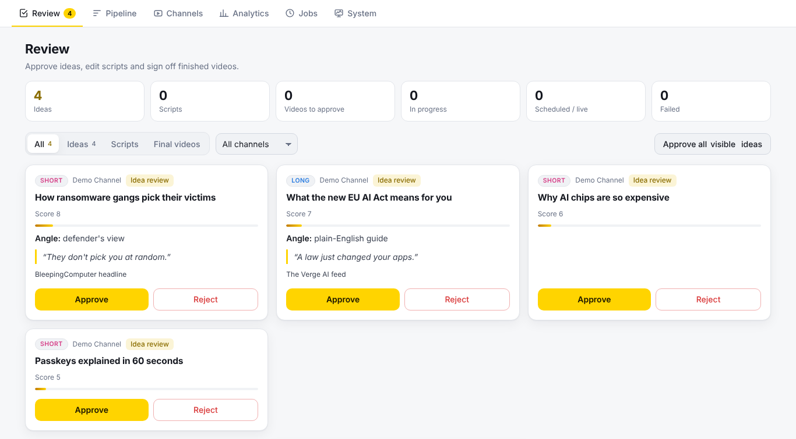

# Usage

## How a video moves through the pipeline
| Status | What happens | Who |
|---|---|---|
| `idea_pending` | Research proposes a topic from trends, news feeds, Reddit, competitors and your past results | **You approve or reject** |
| `scripting` → `script_review` | The LLM writes sectioned narration with a visual for each section | **You edit, approve, or regenerate with notes** |
| `producing` | Voice → visuals → AI animation → captions → render → thumbnail → title, description, tags | Automatic |
| `final_review` | Watch it; adjust title, description, tags or publish time | **You approve** |
| `approved` → `scheduled` | Uploaded as private with a publish time in the channel's next free slot | Automatic |
| `published` | Daily analytics feed the next research run | Automatic |

Turn off a gate per channel with `approval_gates`. A failed step keeps its finished work; **Retry** resumes there.

## Dashboard
| Tab | Use it to |
|---|---|
| Review | Approve ideas, edit scripts, watch and approve finished videos (with download buttons) |
| Pipeline | See every video and its status; search; retry failures |
| Channels | Run research now, reload `channels.yaml`, see which channels are linked |
| Analytics | Views, likes and comments per video and channel |
| Jobs | The worker queue: one job at a time, with results and errors |
| System | Live CPU, memory, disk, network and GPU graphs, busiest processes, and **Restart app / Restart / Shut down** |

It works on phones (bottom tab bar, full-screen video pages) and follows the device's light/dark setting. Use
**Add to Home Screen** for an app icon.



## Command line
```bash
./ytm.sh status                 # services and health (GPU, worker, quota, failures)
./ytm.sh doctor                 # full check with fixes for anything missing
./ytm.sh version                # installed version
./ytm.sh logs [api|n8n|ollama]  # follow logs
./ytm.sh start | stop | restart # the services (after editing .env or settings.yaml)
./ytm.sh key                    # show the dashboard API key
./ytm.sh research <slug>        # research one channel now
./ytm.sh tick                   # push the pipeline forward now
./ytm.sh run <video_id> <script|produce|upload>   # run one step in the foreground
./ytm.sh sync-channels          # reload config/channels.yaml
./ytm.sh auth <slug>            # link a YouTube channel
./ytm.sh fetch-models           # download / re-check the AI image and animation models
./ytm.sh setup-voice [--enable] # install the expressive voice
./ytm.sh voice-sample <slug> ["text"]   # hear a channel's voice
./ytm.sh gpu                    # live nvidia-smi
./ytm.sh backup                 # database, tokens, config and .env -> backups/*.tar.gz
```
Services: `ytm-api`, `ytm-n8n`, `ollama` (start on boot, restart on failure). App log: `logs/ytm.log`.

## Scheduled automation (n8n)
| Workflow | When | What it does |
|---|---|---|
| 01 Daily research | 06:00 daily | Queues research for every channel |
| 02 Pipeline tick | Every 10 min | Moves approved work forward and uploads approved videos |
| 03 Review alerts | Every 30 min | Notifies you when items wait for review |
| 04 Analytics + daily digest | 23:30 daily | Syncs YouTube stats and sends a summary |
| 05 Health watchdog | Every 15 min | Alerts when the API, GPU, worker or quota need attention |

Times use the machine's timezone. For alerts, paste a Discord, Slack or Teams webhook into each workflow's
**Config** node (`notifyWebhook`).

## Before you go live
- **Google API audit.** Videos uploaded through a Google Cloud project that hasn't passed the *YouTube API
  Services audit* are locked private. Run privately while you apply (YouTube API Services → Audit and Quota
  Extension form). The same form raises the 10,000 units/day quota (one upload costs about 1,650).
- **Monetisation.** YouTube demonetises mass-produced, repetitive content. Keep the review gates on, edit scripts
  and add your own angle; that is what the semi-automatic design is for.
- **AI disclosure.** The upload sets YouTube's synthetic-content flag when AI visuals are used. Set
  `contains_synthetic_media: true` for videos showing realistic synthetic people or events.
- **Licences.** Check model, voice, music and stock licences before monetising: see
  [THIRD_PARTY_LICENSES.md](../THIRD_PARTY_LICENSES.md).
- **Custom thumbnails** need a phone-verified channel; otherwise the upload succeeds and the reason is shown in
  the video's History.
